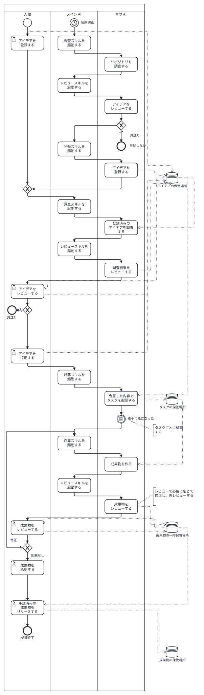

# ソフトウェアファクトリー

新規開発、機能追加、既存リポジトリの改善を Issue として集める。
その中から取り組む Issue を人間が選ぶ。
選んだ Issue について、定期実行されるスキルが調査、設計文書の作成、実装などを進める。

## 用語

| 用語 | 定義 |
| --- | --- |
| **Issue** | 実現したいこととその背景を記録する単位 |
| **タスク** | 調査、設計文書の作成、実装などの作業を表し、作業範囲、状態、受け入れ条件、成果物への参照を管理する単位 |
| **ステップ** | 開始条件、入力、出力で定義する処理の単位 |
| **スキル** | ステップの開始条件を確認し、対象を処理するための手順 |
| **成果物** | 調査結果、設計文書、コードの差分など、タスクで作成または更新するもの |
| **成果物の一時保管場所** | レビュー対象の成果物とレビュー結果を記録する場所 |
| **成果物の保管場所** | 承認済みの成果物を参照できる場所 |

## フロー

AI はリポジトリの調査結果から Issue の候補を作り、レビューを通過した候補を登録する。
レビューの結果、登録を見送る候補もある。
人間も Issue を登録できる。
登録後は AI が Issue を調査し、その結果をレビューして人間のレビューに備える。
新規開発では、対象リポジトリが決まる前から Issue について話し合える。

人間は AI の調査結果を踏まえて Issue をレビューする。
レビューの過程では、AI と Issue の内容を具体化したり、Issue を見送ったりできる。
コメントへの応答もこのやり取りに含まれる。
人間が Issue を採用したら、サブ AI は合意した内容に沿って 1 件以上のタスクを起票する。
たとえば、調査結果をタスクに残し、その結果を使って設計文書を作るタスクを進められる。
調査結果と設計文書は、タスクで指定した保管場所に記録する。

円筒は保管場所を示し、点線の矢印はデータの読み書きを表す。

タスクが着手可能になったら、サブ AI が成果物を作り、AI のレビューを経て人間にレビューを依頼する。
人間のレビューで修正が必要になった場合は、サブ AI が成果物を修正し、再レビューする。
問題がない場合は人間が成果物を承認する。
人間が成果物を承認し、リリースすると判断したら、成果物を指定された保管場所へリリースする。
成果物の一時保管場所と成果物の保管場所に同じ場所を使う場合もある。
人間は成果物に応じたレビュアーを指定できる。

## ステップの実行

メイン AI は定期調査、Issue の採用、タスクの状態などを確認し、開始条件を満たすステップのスキルを起動する。
サブ AI は処理結果を記録して終了する。
あるタスクが人間のレビューを待つ間も、メイン AI は別のタスクのステップを起動できる。

## ステップとサービス

ステップの処理にはスキルを使う。
タスクの操作や成果物の保存には、設定したサービスに対応するスキルを使う。

たとえば、起票スキルは採用された Issue を取得し、タスク管理サービスに対応するスキルを使って起票する。

## ステップの開始条件と入出力

メイン AI がスキルを起動し、サブ AI が次のステップを実行する。
Issue の具体化では、人間と AI がコメントを通じてやり取りする。

| ステップ | 開始条件 | 入力 | 出力 |
| --- | --- | --- | --- |
| リポジトリを調査する | 調査予定時刻に達した | 対象リポジトリの最新のデフォルトブランチ、調査範囲 | Issue の候補と調査の根拠 |
| Issue をレビューする | 調査で候補が見つかった | Issue の候補と調査の根拠 | レビュー結果と登録する候補 |
| Issue を登録する | AI のレビューを通過した候補がある | Issue の候補と登録先 | 登録した Issue と候補との対応関係 |
| 登録済みの Issue を調査する | Issue が登録された | Issue と調査対象 | 調査結果と根拠 |
| 調査結果をレビューする | 登録済みの Issue の調査が完了した | Issue と調査結果 | 人間がレビューする Issue と調査結果 |
| タスクを起票する | 人間が Issue を採用した | 採用された Issue、合意した内容、起票先 | 1 件以上のタスクと Issue との対応関係 |
| 成果物を作る | タスクが着手可能になった | タスク、作業対象、受け入れ条件 | 成果物と検証結果 |
| 成果物をレビューする | 成果物が作成された | 成果物と受け入れ条件 | AI のレビュー結果と人間のレビュー対象 |

## 出力先の設定

設定ファイルで成果物の出力先を指定する。

| 出力先 | 設定する情報 |
| --- | --- |
| GitHub のプルリクエスト | 調査対象リポジトリ |
| Wiki の記事 | Wiki のサービス名 |
| タスクのコメント | タスクの管理に指定したサービスを使う |

スキルは人間による Issue の採用や取り消しを確認する。
採用が起票前に取り消された場合は、未起票分を保留する案とする。
タスクの状態は設定を通じて着手可能などの状態に対応付ける。

## 再実行と重複の防止

Issue、タスク、成果物、レビュー結果の対応を追跡できるようにする。
同じ Issue の候補の再発見や処理の中断に備え、登録済みの Issue や作成済みのタスクを照合してから再開する。
1 件の Issue から複数のタスクを起票する途中で中断した場合は、起票済みのタスクを確認して残りを作る。
同じ対象への処理が重なった場合も、起票や投稿が重複しないよう実行を調停する。
