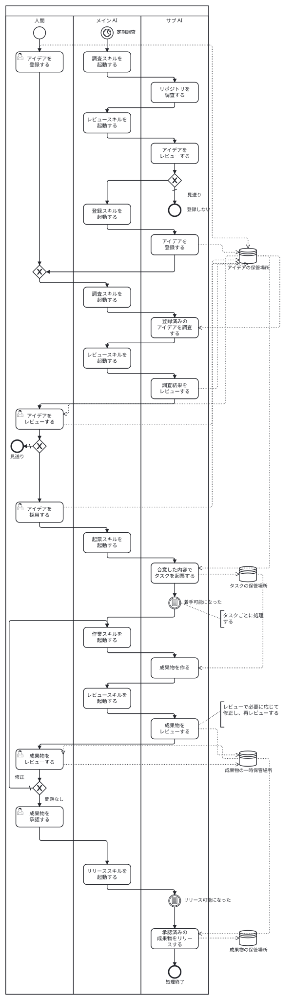

# ソフトウェアファクトリー

新規開発、機能追加、既存リポジトリの改善をアイデアとして集める。
その中から取り組むアイデアを人間が選ぶ。
選んだアイデアについて、定期実行されるスキルが調査、設計文書の作成、実装などを進める。

## 用語

| 用語 | 定義 |
| --- | --- |
| **アイデア** | 実現したいこととその背景を記録する単位 |
| **タスク** | 調査、設計文書の作成、実装などの作業を表し、作業範囲、状態、受け入れ条件、成果物への参照を管理する単位 |
| **ステップ** | 開始条件、入力、出力で定義する処理の単位 |
| **スキル** | ステップの開始条件を確認し、対象を処理するための手順 |
| **アダプター** | ステップからの依頼をサービス固有の操作に変換し、結果を共通の形式で返す実装 |
| **成果物** | 調査結果、設計文書、コードの差分など、タスクで作成または更新するもの |
| **成果物の一時保管場所** | レビュー対象の成果物とレビュー結果を記録する場所 |
| **成果物の保管場所** | 承認済みの成果物を参照できる場所 |

## フロー

AI はリポジトリの調査結果からアイデアの候補を作り、レビューを通過した候補を登録する。
レビューの結果、登録を見送る候補もある。
人間もアイデアを登録できる。
登録後は AI がアイデアを調査し、その結果をレビューして人間のレビューに備える。
新規開発では、対象リポジトリが決まる前からアイデアについて話し合える。

人間は AI の調査結果を踏まえてアイデアをレビューする。
レビューの過程では、AI とアイデアの内容を具体化したり、アイデアを見送ったりできる。
コメントへの応答もこのやり取りに含まれる。
人間がアイデアを採用したら、サブ AI は合意した内容に沿って 1 件以上のタスクを起票する。
たとえば、調査結果をタスクに残し、その結果を使って設計文書を作るタスクを進められる。
調査結果と設計文書は、タスクで指定した保管場所に記録する。

円筒は保管場所を示し、点線の矢印はデータの読み書きを表す。

タスクが着手可能になったら、サブ AI が成果物を作り、AI のレビューを経て人間にレビューを依頼する。
人間のレビューで修正が必要になった場合は、サブ AI が成果物を修正し、再レビューする。
問題がない場合は人間が成果物を承認する。
人間が成果物を承認し、タスクがリリース可能になったら、成果物を指定された保管場所へリリースする。
成果物の一時保管場所と成果物の保管場所に同じ場所を使う場合もある。
人間は成果物に応じたレビュアーを指定できる。
人間はリリース判定を行い、タスクをリリース可能にする。

## ステップの実行

メイン AI は定期調査、アイデアの採用、タスクの状態などを確認し、開始条件を満たすステップのスキルを起動する。
サブ AI は処理結果を記録して終了する。
あるタスクが人間のレビューを待つ間も、メイン AI は別のタスクのステップを起動できる。

## ステップとアダプター

ステップとアダプターの 2 層で構成する。
ステップの処理にスキルを使い、外部サービスとのやり取りをアダプターに委ねる。

たとえば、起票スキルはアイデアのアダプターから採用された内容を取得し、タスクのアダプターを使って起票する。

## ステップの開始条件と入出力

メイン AI がスキルを起動し、サブ AI が次のステップを実行する。
アイデアの具体化では、人間と AI がコメントを通じてやり取りする。

| ステップ | 開始条件 | 入力 | 出力 |
| --- | --- | --- | --- |
| リポジトリを調査する | 調査予定時刻に達した | 対象リポジトリ、リビジョン、調査範囲 | アイデアの候補と調査の根拠 |
| アイデアをレビューする | 調査で候補が見つかった | アイデアの候補と調査の根拠 | レビュー結果と登録する候補 |
| アイデアを登録する | AI のレビューを通過した候補がある | アイデアの候補と登録先 | 登録したアイデアと候補との対応関係 |
| 登録済みのアイデアを調査する | アイデアが登録された | アイデアと調査対象 | 調査結果と根拠 |
| 調査結果をレビューする | 登録済みのアイデアの調査が完了した | アイデアと調査結果 | 人間がレビューするアイデアと調査結果 |
| タスクを起票する | 人間がアイデアを採用した | 採用されたアイデア、合意した内容、起票先 | 1 件以上のタスクとアイデアとの対応関係 |
| 成果物を作る | タスクが着手可能になった | タスク、作業対象、受け入れ条件 | 成果物と検証結果 |
| 成果物をレビューする | 成果物が作成された | 成果物と受け入れ条件 | AI のレビュー結果と人間のレビュー対象 |
| 成果物をリリースする | 人間が成果物を承認し、タスクがリリース可能になった | 承認された成果物、レビュー結果、タスクの状態、保管場所 | リリースした成果物とタスクからの参照 |

## アダプターの選択と設定

設定ファイルで役割ごとにアダプターと操作先を指定する。
同じ役割のアダプターはステップが使う操作と入出力をそろえる。

| 役割 | ステップに提供する操作 |
| --- | --- |
| アイデアの管理 | 登録、コメントの読み書き、採用の確認 |
| タスクの管理 | 起票、状態の読み取りと変更、コメントの投稿 |
| 成果物の一時保管場所 | レビュー対象とレビュー結果の記録、取得 |
| 成果物の保管場所 | 成果物の記録、参照の取得 |
| 変更提案の管理 | 下書きの作成、レビュー依頼、承認の確認、取り込み |

アダプターは人間によるアイデアの採用や取り消しを確認し、ステップに伝える。
採用が起票前に取り消された場合は、未起票分を保留する案とする。
タスクの状態は設定を通じて着手可能やリリース可能などの状態に対応付ける。

## 再実行と重複の防止

アイデア、タスク、成果物、レビュー結果の対応を追跡できるようにする。
同じアイデアの再発見や処理の中断に備え、登録済みのアイデアや作成済みのタスクを照合してから再開する。
1 件のアイデアから複数のタスクを起票する途中で中断した場合は、起票済みのタスクを確認して残りを作る。
同じ対象への処理が重なった場合も、起票や投稿が重複しないよう実行を調停する。
